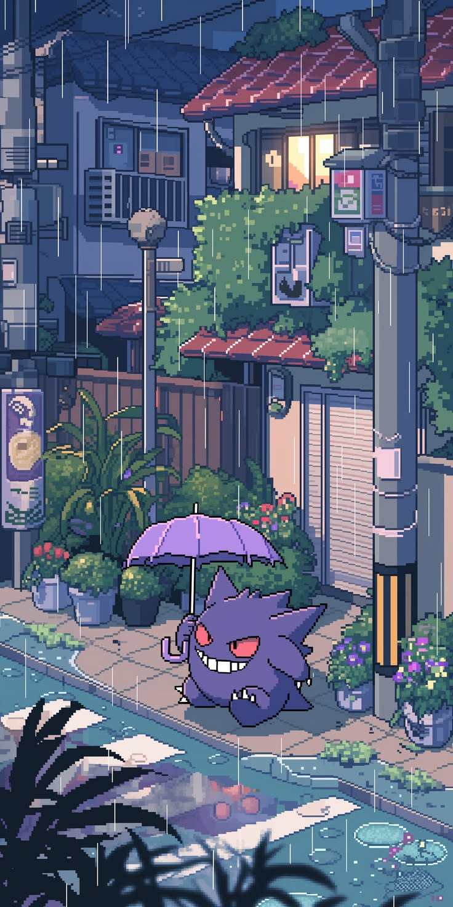

<table>
  <tr>
    <td width="240">
      
    </td>
    <td>
      <h1>¡Hola! Soy Bryan Acosta 👋</h1>
      <h3>Desarrollador Full Stack todo terreno 🚀</h3>
        
      
      
      
    </td>
  </tr>
</table>

---

### 💡 Sobre mí

No me encasillo en una sola cosa.

- 🔭 Actualmente trabajando en proyectos full stack con **Next.js + Supabase**
- 🌱 Explorando **NestJS** y arquitecturas con **Docker**
- 💬 Pregúntame sobre desarrollo web, apps de escritorio con Electron, o automatización
- ⚡ Versátil: si hay que aprender una tecnología nueva para resolver el problema, la aprendo
